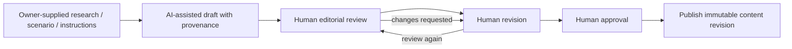

# AI-Assisted Content Production Architecture

**Status:** Accepted human-reviewed internal workflow; provider integration is Deferred. No model/provider integration or AI code is created.

## 1. Scope and boundary

AI supports MaliLab's internal research and editorial production: organizing supplied research, structuring Modules/Lessons, drafting Lesson and Playbook content, generating scenario drafts, and improving readability/consistency. It is not a user-facing financial advisor/chatbot and cannot access learner Notes, Practice responses, income, plans, or calculations. Voice/audio functions are excluded.

The editorial/content domain remains the system of record. AI is a draft producer, not a content owner, source of truth, reviewer, or publisher. Direct provider integration is not required to implement the initial learning loop and remains an optional internal capability pending owner decision.

## 2. Required workflow

This preserves the required sequence: **Draft → Review → Revision → Approval → Publication**. Review must be human and occur before publication. Rejected or unapproved output remains private draft material.

## 3. Provenance and safety

If AI integration is later enabled, retain with the draft as appropriate: source identifiers/URLs supplied, prompt/instruction version, model/provider identifier, generation timestamp, and which portions were generated or human-edited. Human editors verify factual statements, assumptions, citations, current rates/regulatory/product facts, and limitations. Generated sources are not accepted as verified evidence solely because a model supplied them.

No automatic publication, calculator formula generation into production, automatic investment recommendation, or user-facing financial response is allowed under this architecture. Do not transmit user-owned financial data to an AI provider. Provider retention, training use, data location, cost, and contractual terms must be reviewed before choosing an integration.

## 4. Integration options

| Option | Evaluation |
|---|---|
| Manual AI-assisted drafting outside MaliLab, then editor imports draft | Lowest integration/privacy/operational cost; may be enough initially. Provenance can be recorded manually where relevant. |
| Explicit internal admin action via provider adapter | Could improve consistency and preserve generation metadata; adds external dependency, credentials, data-flow and cost concerns. Optional future path. |
| Autonomous content agent/pipeline | Rejected for initial architecture: conflicts with mandatory human review and introduces unnecessary publication/data risk. |
| User-facing financial chatbot | Excluded from initial scope and not designed here. |

Recommended baseline: content workflow supports a clearly marked draft and provenance fields, while generation can remain external/manual. Add a provider adapter only after a specific need, data policy, provider assessment, and owner approval. No worker is justified until generation latency/volume requires one.

## 5. Domain interaction

An AI-produced draft enters the same Editorial Content revision and Editorial Workflow as any human draft. AI metadata is provenance attached to draft/revision, not a separate published-content store. Editorial Workflow enforces reviewer action before publish. Search only indexes the resulting published version.

## 6. Unresolved decisions

TODO/TO-BE-DEFINED: which provider/tools are acceptable; whether integration belongs in the initial admin; permitted source/data classes; provenance detail; reviewer checklist; source licensing; prompt evaluation; privacy/retention; human accountability and editorial authority. No technical provider choice is made.
