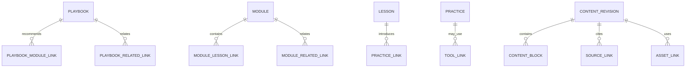

# Content Architecture

**Status:** Accepted conceptual/logical content architecture, detailed by the Phase 4 data specification. It is not database DDL; physical representation remains deferred to implementation.

## 1. Content principles

- Treat Playbooks, Modules, Lessons, Practice definitions, and tool explanations as structured editorial content with stable identities and separately versioned revisions.
- Keep canonical authored content independent from page templates and frontend components.
- Render a constrained set of typed content blocks. Do not store arbitrary executable markup or let editorial HTML bypass safe rendering.
- A content edit creates a new revision; publishing selects a revision. Previously published revisions remain addressable for historical Notes, Progress, and source context.
- The human editorial workflow owns approval. AI can produce only an explicit draft and cannot publish.
- Keep links explicit and typed. A useful initial relationship set is Playbook-to-Module, Module-to-Module (related), Lesson-to-concept/term, and content-to-source/asset. Do not build a general graph engine now.

## 2. Content hierarchy and relations

The diagram shows conceptual relationships only. Link records carry editorial ordering and relationship kind where necessary. The same Module can be recommended by multiple Playbooks; it is not duplicated. Module Lesson order is explicit. Prerequisites remain absent unless approved.

## 3. Content identity versus revision

Each authored item has a stable identity and a sequence of revisions. A revision contains the editorial snapshot and metadata needed to render that version. Draft changes do not mutate a published revision. A publication operation identifies which approved revision is current for public reading. Retiring content changes its discoverability/current status; it does not erase historical revisions.

User progress records identify the relevant content identity and revision studied. Notes/highlights identify revision and preferably block identity plus a text/position anchor sufficient to show the original context; exact anchoring is a later UX/data decision. A learner journey that originates from a Playbook refers to its exact published Playbook revision and the revision-specific Playbook→Module recommendation followed. A saved Practice attempt, plan revision, or Progress evidence may point to this learning-context association and the relevant Module/Lesson revisions. It preserves references to immutable editorial revisions, not copied Playbook prose. On content replacement, do not silently retarget historical progress, notes, or journey context. A user can be shown the current revision separately from their historical reference.

### Proposed lifecycle

`Draft → In Review → Changes Requested → In Review → Approved → Published → Retired`

Rejected/withdrawn drafts remain non-public and may be retained under an editorial retention policy. A correction to already published content produces a new revision and a new review/publish event. Only an approved version can be published. The status taxonomy and ability to republish a retired item require editorial policy approval.

## 4. Structured lesson content

Store ordered, typed blocks within a Lesson revision. A block has a stable block identifier, type, structured payload, and display order. Initial candidate block types, reflecting approved editorial requirements, are:

- Heading and short paragraph
- Key insight/callout
- Ordered/unordered list
- Example or Kenyan financial context
- Table (accessible header/body structure)
- Warning/limitation/disclaimer
- Practice prompt/reference
- Lab Tool reference
- Source/reference list
- Related concept/Playbook/Module reference
- Image/diagram asset reference

This is a content capability list, not a locked curriculum or mandatory template. Lessons can combine blocks flexibly. A versioned content schema and validation rules should reject unknown unsafe block types; presentation components map known types to semantic HTML. Keep calculation formulas out of block payloads: a block references a versioned Lab Tool definition.

JSON-like block payloads are an implementation recommendation, not a physical schema decision; see data architecture. Avoid storing entire lessons as one arbitrary HTML blob because validation, safe rendering, references, and evolution would be difficult. Avoid one database record/table per paragraph/block as the default because it makes authoring and rendering unnecessarily fragmented.

## 5. Playbook structure

A Playbook revision can carry title, summary, cover asset reference, scenario/context, audience framing where editorially relevant, financial situation, stated assumptions, desired outcome, investigation questions, recommended Module links, related concepts, related Playbooks, practical experiments, Lab Tool links, and discovery metadata. All fields are optional/conditional per the approved flexible Playbook model; no template requires the same sections for every item.

Discovery metadata should distinguish authored title/summary/topic labels from generated search text. Search results resolve to the current published version. No personalization or advanced ranking is required.

## 6. Module and Lesson structure

A Module revision holds descriptive information, an ordered set of Lesson relationships, and a **versioned learning-requirement set**. Each applicable Lesson and Practice relationship can be classified as **required**, **optional**, or **recommended** in the logical model. Recommended Practice is supported as a relationship label, not a requirement that any particular activity use it. These classifications belong to the Module revision, so changing order or requirements creates a new revision and does not change the meaning of prior completion.

The same Lesson or Practice definition may be linked by more than one Module; links do not duplicate the underlying content. Lesson identity belongs to one or more Module relationship only if content policy approves reuse; otherwise membership is explicitly versioned. Lesson order has a stable position within a Module revision. Optional/recommended items do not block Module completion. Prerequisites are separate from these classifications and remain absent unless approved.

### Conceptual completion rule

A learner's Module completion is evaluated against the exact Module revision and its requirement set. The Module is complete when every required Lesson and required Practice item in that revision meets its own approved completion/attempt condition. Optional and recommended items are shown as learning choices but do not block completion. The Progress explanation identifies the Module revision, required items satisfied, and any required items remaining. No arbitrary percentage is used.

The precise meaning of a Lesson being complete, a Practice being complete/attempted, and whether any activity-specific thresholds apply remain product decisions. Meaningful learning achievement remains distinct: it requires Module completion plus a practical plan attempt as defined in the approved product specification.

## 7. Sources, provenance, and editorial workflow

Source records may identify cited research/material, but they are not the sole historical provenance record because source metadata can change. At review/publication, each Content Revision preserves a **source provenance snapshot** of applicable information as then reviewed: source identity, URL/reference, title, publication date, retrieval/access date, relevant source version/reference, and the relation to the content where applicable. The content review action separately records reviewer and review timestamp against that revision. Exact citation format and verification obligations are TODO/TO-BE-DEFINED. Source records are not proof of truth; a human reviewer remains accountable for publication.

Review history records revision, reviewer, action, time, and rationale/comment as appropriate. Publishing history identifies the approved revision and actor. Keep audit history for changes to editorial publication state. Do not infer jurisdictional compliance obligations.

## 8. Relationships and future knowledge support

Use typed, directed relationships and explicit metadata for approved links. Initial needs are direct content links (Playbook → Module, Module → Lesson, Lesson → Practice/Tool, and related content). Terms/concepts may be referenced when needed for the core loop. The full Dictionary, broad entity taxonomy, and large knowledge graph remain future scope. A cross-linkable content architecture does not require graph database technology or generalized graph traversal.

## 9. Search projection

Search uses only currently published content. Maintain a rebuildable projection/index derived from published title, summary, body text, topic/category labels, and links. Drafts and private user inputs are excluded. Update projection on publish/retire and allow full rebuild from canonical revisions. PostgreSQL search is recommended initially. Ranking, language stemming, and exact indexed fields need UX/content examples before final tuning.

## 10. Media

Content references assets by stable asset identity, not hard-coded filesystem paths. Initial asset types are cover images, lesson illustrations/diagrams, and approved downloads if required. No audio asset type is in scope. Upload permissions, allowed formats, size limits, image variants, rights/attribution, alt text, retention, and object storage are detailed later. See [TECHNOLOGY_DECISIONS.md](TECHNOLOGY_DECISIONS.md).

## 11. AI-created drafts

An AI-assisted draft must be distinguishable from editorial text, preserve supplied source/provenance references and generation context where available, and enter the same human review and publication workflow as other drafts. No generated text, sources, calculator assumption, or content link can publish automatically. Do not pass user Notes, Practice responses, plan data, or calculation scenarios to a content-generation provider.

See [AI_CONTENT_PRODUCTION.md](AI_CONTENT_PRODUCTION.md) for workflow and integration boundaries.
