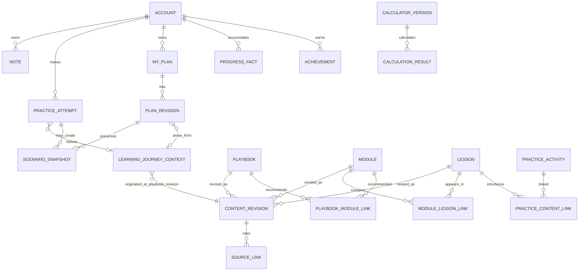

# Data Architecture

**Status:** Accepted conceptual/logical model direction, expanded by the Phase 4 data specification. No physical database schema, ORM model, or migration is created; implementation choices remain deferred.

## 1. Data ownership and classes

### Editorial data

Playbooks, Modules, Lessons, Practice definitions, tool descriptions, sources, review history, content revisions, publication links, topics, and media references are MaliLab-owned editorial data. Draft/review data is staff-only. Published content is readable according to the still-unresolved public access policy.

### User-owned data

Notes/highlights, Practice attempts/responses, saved scenario inputs and results, My Plan revisions, progress, and achievements belong to one account. Income and investment assumptions are sensitive personal information. Enforce ownership in application authorization on every read/write; do not expose this data to search, public APIs, content authors, or product analytics by default.

### Operational data

Authentication/session metadata, security audit events, and application logs support operations. Do not log financial inputs, note text, plan payloads, credentials, or secrets. Detailed retention schedules and any regulatory obligations are TODO/TO-BE-DEFINED.

## 2. Conceptual model

Conceptual aggregates: **Account**, **Editorial Content**, **Editorial Workflow**, **Calculation Definition**, **User Scenario/Plan**, **Learning Evidence**, and **Asset**. References between aggregates are explicit; no graph database is implied.

## 3. Logical model — proposed record concepts

Logical concepts below describe information and relationships, not final field definitions or physical tables.

### Identity and accounts

- **Account:** authentication identity, lifecycle state, creation/update timestamps, and ownership boundary. Registration method and profile requirements are unresolved.
- **Profile/Preferences (optional):** only add user-provided settings needed for an approved experience. Do not create a broad demographic or financial profile by default. Current income/desired income belong to explicit plan/scenario context, not a silently inferred profile.
- **Role/Permission:** user access and staff capabilities. Can map to framework permissions; no need to invent a complex organizational model.

### Editorial content and versions

- **Playbook / Module / Lesson identity:** stable identity, editorial key/title metadata as needed, lifecycle pointer to current published revision, and relationships to revisions.
- **Content Revision:** immutable editorial snapshot, revision sequence, state, authored structured body/metadata, editor and timestamps, and publication reference when approved.
- **Playbook–Module Link:** relationship kind/order captured in the Playbook revision, so one Module can serve many Playbooks and a learning journey can identify exactly which recommendation was followed.
- **Module Learning Requirement:** ordered membership plus a revision-scoped classification of required, optional, or recommended Lesson or Practice item. Recommended Practice is supported by the logical model, but its use is not a requirement for any specific activity. The learning requirement set is versioned with the Module revision; final physical representation remains for implementation.
- **Lesson–Practice / content links:** explicit typed references to activities, tools, concepts, and related material.
- **Content Source / Revision Provenance Snapshot:** source identity/metadata plus a revision-scoped snapshot of the source URL/reference, title, publication date, retrieval/access date, relevant source version/reference, and relationship to reviewed content where applicable. A mutable source catalog alone is insufficient.
- **Review Action / Publication Event:** reviewer, action, timestamp, revision, and rationale where appropriate; append-only history is preferred. The review timestamp is the content review date for that revision.
- **Topic/Category:** controlled editorial discovery labels, taxonomy TBD.
- **Financial Concept / Dictionary Term:** optional light-weight link concepts when needed for core content; full taxonomy and dictionary remain future scope.
- **Media Asset:** stable reference, storage locator abstracted behind storage layer, media type, metadata/alt text, rights/source attribution as defined; no audio asset.

### Practice, calculation, and scenario

- **Practice Activity Definition:** versioned editorial activity/prompt and its input/response expectations; avoid assuming quiz correctness.
- **Practice Attempt:** account owner, activity revision, attempt state/time, user's answers/reflection, and optional scenario/plan references. Retention and edit policy TBD.
- **Calculator Definition / Formula Version:** stable calculator identity and immutable formula version. Conceptual lifecycle: `Draft → Tested → Reviewed → Approved → Active → Retired`. A transition to Active requires an explicit approval/activation action and evidence that the version has a formula definition, assumptions, test cases, expected results, source/reference, reviewer, approval timestamp, and version identifier. Merely existing in code is not activation. Exact gates and actors remain for product/editorial and implementation definition.
- **Calculation Result:** formula version, normalized input snapshot, explicit assumptions, calculation timestamp, typed outputs, and explanatory/limitation references. Treat saved results as reproducible historical outputs, not live promises.
- **Scenario / Assumption Snapshot:** user-owned named or contextual set of assumptions, formula/result reference, and association to Practice or plan revision. Whether users compare multiple scenarios is unresolved.

### Personal planning and learning evidence

- **My Plan:** account owner and link to its current revision. One-versus-many plan cardinality is unresolved.
- **Plan Revision:** **immutable snapshot** of a user's target definition, timeframe, assumptions, possible path, relevant Practice attempt, relevant calculation result and formula version, learning context, and Playbook/Module/Lesson revision context where applicable. Each revision conceptually references its previous revision. Editing creates a new revision; it never mutates historical financial thinking. Revision snapshots permit previous/current comparison without recalculating or overwriting old results. Exact content fields and comparison UI remain unspecified.
- **Learning Journey Context:** user-associated reference bundle identifying the originating Playbook revision, the revision-specific Playbook→Module recommendation followed, relevant scenario/context and assumptions, and subsequent Module/Lesson revisions as they are studied. It references immutable editorial revisions and does not copy their text. Practice attempts, Plan Revisions, and Progress evidence can reference this context.
- **Note:** account owner, text/insight, timestamps, and optional source content revision/block reference. Highlight/annotation anchoring details remain open.
- **Progress Fact:** account owner, fact kind (e.g., studied/completed intended Lesson, completed/attempted required Practice, created plan attempt), exact content revision/context, timestamp, and explanation/evidence reference. A Module completion record identifies the Module revision and requirement set, each required item and whether its approved condition is satisfied, and outstanding required items. Optional/recommended Lesson or Practice items are not completion blockers. Do not reduce to a percentage.
- **Achievement / Badge Definition:** minimal user achievement record references Module completion evidence and practical plan attempt evidence satisfying approved conceptual criteria. Detailed rules, display, reversal/re-evaluation, and badge catalogue are TBD.

## 4. Lifecycle, mutability, and deletion

| Data | Owner | Lifecycle / mutability | Versioning | Deletion / retention direction |
|---|---|---|---|---|
| Published editorial identity/revisions | MaliLab | Stable identity; revisions immutable after publish; retirement changes discovery state | Revision per editorial change | Do not cascade-delete historical revisions referenced by user evidence; retention policy TBD. |
| Draft/review records | MaliLab editorial | Mutable until submitted/approved; workflow actions retained | Revision and review-action history | Retain or purge rejected drafts under editorial policy; TBD. |
| Source/asset references | MaliLab editorial | Metadata may be corrected; content references stable | Keep source association per revision | Missing/deleted asset handling and retention TBD; published references must not silently break. |
| Account | User / platform | Active, suspended, deletion-requested, deleted states to be defined | Audit lifecycle actions | Account deletion/export and legal retention obligations TBD. |
| Notes and Practice responses | User | User-editable/deletable subject to approved lifecycle | Version history only if needed for plan/evidence; TBD | User deletion behavior, backups expiration, and retention TBD. |
| Plan and scenario revisions | User | Every saved edit creates an immutable revision; previous revision remains unchanged | Previous-revision chain; scenario/calculation/context references | User controls and deletion behavior TBD; stored financial data needs minimization. |
| Calculation definition/result | MaliLab definition / user result | Formula version immutable through lifecycle; result snapshot immutable | Explicit formula version, input/assumption snapshot, and calculation timestamp | Keep result's assumptions; deletion with user data policy; retain formula version and test/reference evidence needed for interpretation. |
| Progress/achievement evidence | User-owned derived record | Explainable facts; no arbitrary score. Correction/revocation policy TBD | References Module revision/requirement set, item revisions, plan revision, and learning journey context | Deletion/anonymization behavior follows account lifecycle and policy TBD. |
| Search projection/index | Derived from published content | Rebuildable; current published revisions only | Rebuild on publication changes | Delete/rebuild when source content is retired; never contains private user data. |
| Operational logs | Platform | Restricted, short-lived as policy defines | No content/user payload | Retention and access policy TBD; exclude sensitive values. |

Do not claim regulatory retention requirements without evidence. Establish export, deletion, backup expiration, and retention rules in a later security/privacy decision.

## 5. Logical relationship rules

- One Playbook may recommend multiple Modules; one Module may serve multiple Playbooks.
- One Module contains ordered Lessons. Ordering is version-contextual. Prerequisites and completion gates are not inferred.
- Lessons can link to Practice activities and Lab Tools without embedding their calculation implementation.
- A Practice attempt belongs to one Account and references the specific activity revision.
- A saved Calculation Result identifies one Calculator Version and input/assumption snapshot.
- A Plan has one Account owner. Cardinality of plans per account remains unresolved. Every saved Plan Revision is immutable and points to its predecessor (except the first); a new edit or recalculation creates a new revision/snapshot.
- A Plan Revision can reference a Practice attempt, Calculation Result and exact Formula Version, Learning Journey Context, and relevant published Playbook/Module/Lesson revisions. These are references, not duplicated editorial text.
- A Learning Journey Context points to the exact Playbook revision and exact recommendation relationship followed, then to the relevant Module/Lesson revisions; scenario and assumption context is preserved by reference/snapshot as appropriate.
- Module completion is evaluated against that exact Module revision's required Lesson and required Practice set. Progress preserves the evidence and explains satisfied/missing requirements; optional/recommended Lesson or Practice items do not block completion.
- Notes and Progress reference exact published content revisions where possible.
- Achievements refer to explainable Progress evidence, not opaque point totals.
- No content entity stores user-owned input directly. User records refer to editorial definitions by stable ID and version.

## 6. Constraints and indexing considerations (logical)

Enforce unique stable content keys within a content type; unique revision sequence per content identity; one current published revision per identity; valid relationship endpoints and order uniqueness within a Module revision; immutable published revisions; one owner per user record; valid formula-version references; and safe numeric input bounds. These are logical constraints only; final DB constraints are later.

Physical indexes will likely be needed for owner-plus-updated-time access to private data, content type/status/current publication, ordered Module Lesson retrieval, typed relationship traversal, source references, formula-version lookup, and PostgreSQL text search over published content. Final index design follows measured query patterns and physical implementation.

## 7. User-data isolation decision

The initial architecture uses application-level ownership checks as the mandatory authorization boundary: every use case scopes a user-owned object to the authenticated account; staff capabilities are separate; tests must exercise cross-account reads, updates, deletes, identifiers, list/search paths, and related-object references. Query/repository helpers should make owner scope hard to omit.

**PostgreSQL row-level security (RLS) is not required in the initial architecture.** The initial system is one trusted Django application with a small number of controlled database access paths. RLS would add per-connection identity context, migration/admin complexity, and potential pool/transaction mistakes without replacing application authorization. Keep the option open and reassess if additional services, direct DB consumers, or a higher-risk access pattern are introduced. This decision does not weaken the requirement for authorization tests and private DB access.

## 8. Logical schema vs physical implementation

**Conceptual model:** user/account, versioned editorial knowledge, calculation definitions/results, personal plans/scenarios/notes, and explainable learning evidence.

**Logical model:** record concepts, ownership, versioning, links, and lifecycle above. It distinguishes editorial and user-owned records and content identity from immutable revision.

**Physical implementation:** not defined or created. PostgreSQL is recommended; Django ORM mapping, table names, exact columns/types, indexes, constraints, row-level policies, migrations, encryption configuration, and retention jobs belong to later design/implementation gates.

## 9. Physical database recommendation

Use PostgreSQL as the initial relational system. Keep canonical relationships relational; store structured lesson block payloads as schema-validated JSON documents within a content revision where appropriate, with searchable text projected/indexed separately. Do not use JSON as a substitute for ownership or relationships. See [TECHNOLOGY_DECISIONS.md](TECHNOLOGY_DECISIONS.md).
