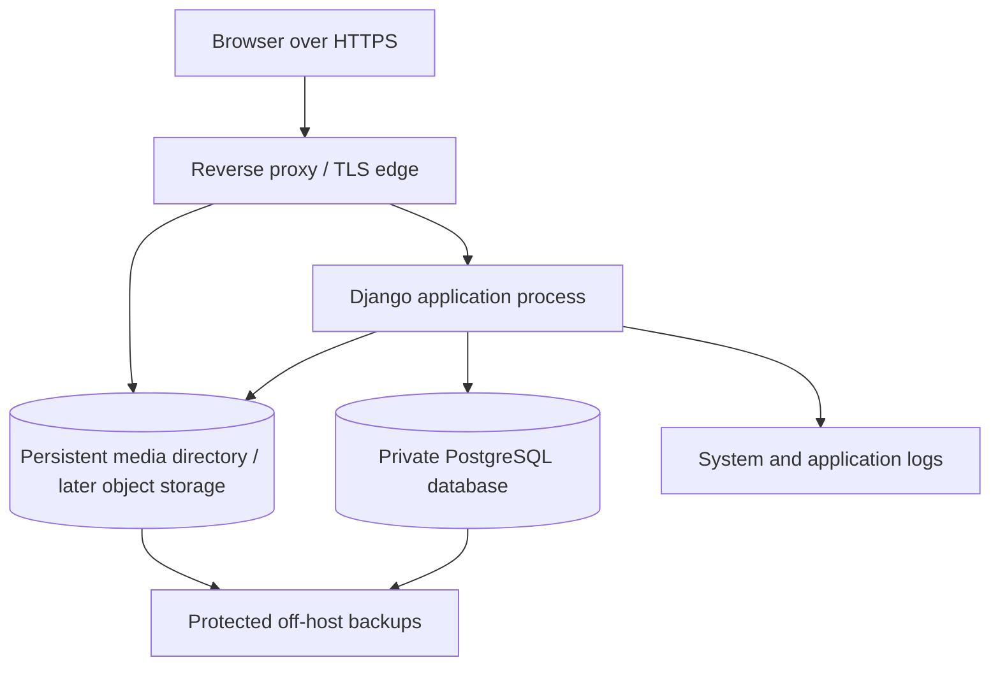

# Deployment Architecture

**Status:** Deployment principles accepted; physical topology and production configuration Deferred to deployment phase. No package installation, server inspection, service, proxy, database, or production configuration is performed.

## 1. Recommended deployment shape

For the first production deployment, the components may be co-located only if resource and isolation review confirms capacity; this is not a decision to place them on the current legacy host. Do not assume the current host has capacity or alter the legacy deployment. The new app uses its own service identity, database, credentials, media path, environment configuration, and logs. No code, DB, migrations, settings, or deployment configuration is shared with `/home/opc/malilab_legacy`.

An existing reverse proxy may be reused only after the deployment phase inspects its configuration, confirms a non-conflicting route/domain, and receives deployment approval. This phase does not inspect or edit it.

## 2. Environments

| Environment | Purpose | Isolation recommendation |
|---|---|---|
| Development | Local engineering, seeded non-production content, test accounts/data | Separate settings and DB; never copy production personal data into local fixtures. Local run method remains undecided. |
| Staging | Validate content publication, migrations, calculator changes, and release/rollback behavior before production | Recommended before production releases. Separate DB, secrets, media, hostname, and staff access. Whether it is a separate host or isolated process on another environment is TBD by capacity/cost. No real user data by default. |
| Production | Public/learner service and canonical data | Isolated app configuration, PostgreSQL database, media path, secrets, logs, restricted DB access, backups. Existing legacy stack remains untouched. |

Public versus account-required access for learning pages remains a product/UX decision and does not change the environment boundary.

## 3. Application process and proxy

Future host deployment uses a production-grade Django WSGI server (Gunicorn is the recommendation in the technology evaluation) bound to a private socket/loopback, with a reverse proxy handling public connections, TLS, request limits, static assets, and media delivery. A systemd unit is a likely Oracle Linux host-native supervisor. Exact worker counts/timeouts and proxy policy follow implementation/load review. Do not use the Django development server in production.

No nginx or systemd configuration is created in Phase 3.

## 4. Database, static assets, and media

- PostgreSQL is the application source of truth. Keep it private; allow access only from the application and approved administrative/backup paths.
- If initially co-located, use a dedicated database and credentials for the new application, separate from any legacy data.
- Static build assets are immutable/versioned and can be served by the reverse proxy.
- Editorial media uses an explicit media root or object-storage adapter, separate from source code and static build output. Never treat ephemeral release directories as media storage.
- No user-generated media/audio upload capability is assumed.
- Database and media backups must be protected and restorable. **Before production data is considered safe, establish an off-host backup and validate restoration of both database and media.** Frequency, retention, encryption keys, and recovery objectives remain TODO/TO-BE-DEFINED.

## 5. Production capacity gate

Production deployment is conditional on reviewing the actual Oracle Cloud host and workload. Validate:

- **CPU:** available capacity for the application, PostgreSQL, proxy, and existing unrelated workloads at expected concurrency.
- **Memory:** application worker and database memory headroom without swapping or destabilizing existing services.
- **Disk:** database growth, media, logs, temporary files, backups, and free-space alerts.
- **Database:** connection capacity, storage/IO, isolation, backup method, and recovery behavior.
- **Media:** persistent path, capacity growth, permissions, delivery, and backup/restore.
- **Backup:** off-host destination, protection/access, coverage, retention, and successful restore validation.
- **Restore:** rehearsed recovery for database and media with documented owner and acceptable recovery objectives.

Until these checks pass and the deployment phase is approved, the physical host placement and same-host topology remain deferred. This document does not inspect or change the server.

## 6. Configuration and secrets

Keep environment-specific configuration outside source control. Inject secrets at process start through a protected deployment mechanism, not source files or logged commands. Separate development, staging, and production keys/credentials. Required settings include database connection, application secret, allowed hosts/origins, email/provider settings only if selected, static/media paths, and logging. Exact values are not created here.

## 7. Release, migrations, rollback

1. Build a versioned release artifact from reviewed source in a later implementation phase.
2. Validate in development/staging with schema/content migration review and backup/restore rehearsal appropriate to the change.
3. Take/verify a recoverable database and media backup before production changes that could affect data.
4. Apply backward-compatible migrations in a controlled order, then release the application process.
5. Run health checks and a small set of smoke checks; monitor errors.
6. Roll back application code if safe. Database migrations must be backward compatible or have an explicit restore/forward-repair plan; do not assume code rollback reverses data changes.

Migration tooling and deployment automation are not selected in this phase. Do not create migrations now.

## 8. Health, logs, and recovery

Future deployment should expose a health check that distinguishes app readiness and database connectivity without disclosing secrets. Capture structured application logs and proxy/process/database health with sensitive fields redacted. Define alerting, log retention, backup frequency, recovery-point/time objectives, and restoration owner before production. See [SECURITY_ARCHITECTURE.md](SECURITY_ARCHITECTURE.md).

## 9. Deployment decisions requiring later evidence

TODO/TO-BE-DEFINED: existing host CPU/memory/disk and legacy workload; domain/DNS/TLS; network/firewall rules; whether database shares host; OCI/object storage account and cost; backup target; staging host; email need; expected concurrency/availability; deployment automation; patch/monitoring ownership. Resolve at deployment phase without modifying legacy services.
