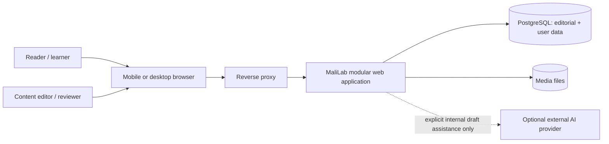

# MaliLab System Architecture

**Phase:** 3 — Architecture and Technical Decisions  
**Status:** Phase 3 architecture approved with required refinements incorporated; no implementation or infrastructure changes have been made.

## 1. Architectural summary

Build the initial MaliLab as a **modular monolith**: one Django web application, organized around explicit product domains, with one PostgreSQL database and server-rendered, mobile-first pages. The application owns workflows and authorization. Domain modules interact through application services and explicit interfaces inside the same process. Do not create a separate deployed service per domain.

Use server-rendered HTML for discovery, reading, editorial administration, and personal workspace flows. Add progressive JavaScript for interaction; use authenticated JSON responses only where a product interaction benefits from them, especially calculator/scenario exploration. Keep calculation logic in a versioned, deterministic domain service and never in presentation code.

Use PostgreSQL as the authoritative store for editorial and user-owned records. Model published content as immutable versions selected by a current publication pointer. Module revisions carry a versioned learning-requirement set. Preserve the version context of the originating Playbook/recommendation, learning progress, notes, calculations, sources, and immutable plan revisions. Start without a cache, message broker, background worker, dedicated search service, or microservices.

For a first deployment, target an isolated MaliLab application stack on Oracle Linux 9: reverse proxy, Django application process, PostgreSQL, and persistent media storage. The existing proxy may be reused only after a deployment-phase inspection and approval. Do not touch the retired application or its deployment.

## 2. System context and boundaries

The initial application boundary contains identity/account workflows, a content-access policy boundary, published content delivery, Playbook discovery, Module/Lesson learning with revision-scoped requirements, Practice, calculation/scenario services, My Plan with immutable revisions, Notes, explainable Progress and minimal achievements, content administration and editorial workflow, database-backed basic search, and minimal asset management.

Product analytics, a full Dictionary/knowledge graph, advanced recommendation, subscription/payment, notifications, an advanced user-facing AI assistant, audio, and podcast capabilities are not initial domains. Keep extension points at module interfaces and content relationships; do not create inactive services or schemas for speculative capabilities.

## 3. Domain request and data flows

### Learning and planning

1. A reader discovers a published Playbook through a rendered discovery surface or basic search. The learning journey context references the exact Playbook revision.
2. The Playbook links to published Module versions; the followed recommendation relationship is preserved. Modules contain ordered Lessons and revision-scoped learning requirements.
3. The reader studies Lesson content. Any progress record points to the content version studied.
4. A Practice activity gathers exploratory inputs/reflection and may invoke a Lab Tool.
5. The calculation service validates inputs and runs a selected formula version. It returns outputs with assumptions, methodology, calculation date, and limitations.
6. The authenticated user's plan/scenario preserves target, assumptions, outputs, prior revision, and learning context as an immutable Plan Revision snapshot.
7. Learning Delivery, Practice, and My Plan produce facts/evidence; Progress consumes them one way, evaluates required items against the exact Module revision, and explains satisfied/remaining requirements. Achievements may consume Progress evidence. My Plan never depends on Progress to operate.

Exact gates and completion thresholds remain product decisions; no percentage-based progression is introduced by architecture.

### Editorial publication

An editor creates or revises a draft content version, attaches source provenance, requirements, and relationships, requests review, and makes required revisions. A human reviewer approves a version before publication. The reviewed revision preserves a snapshot of relevant source identity/reference/title/date/version and reviewer/review timestamp. Publishing atomically changes the current-publication pointer and search projection. A later edit creates a new version; it does not rewrite the version linked from historical user records.

### Calculation

The web layer validates request shape and authorization, then calls a pure calculation use case with explicit inputs and assumptions. Only a formula version that passed Draft → Tested → Reviewed → Approved → Active can run. Required test cases/expected results, formula definition, assumptions, source/reference, reviewer, approval timestamp, and version identifier are activation evidence. The calculator returns a typed result; persistence of a scenario/result is a separate user-owned workflow. A saved result records the formula version, inputs, assumptions, result, and calculation timestamp so it remains reproducible later. Do not execute user-supplied formulas or code.

## 4. Domain boundaries and coupling

See [DOMAIN_ARCHITECTURE.md](DOMAIN_ARCHITECTURE.md) for responsibilities, data ownership, inputs/outputs, dependencies, workflows, and initial scope. Domains share one deployment and database initially, but a domain must not write another domain's records by bypassing its application interface. Cross-domain relationships use stable identifiers and explicit services.

Use synchronous application-service calls and database transactions for initial workflows. Learning Delivery, Practice, and My Plan produce durable facts/evidence; Progress consumes them and never calls those domains back. My Plan does not require Progress to save or revise a plan. Do not introduce domain-event infrastructure, a message broker, or distributed transactions. In-process coordination may be used internally, but domain dependency direction remains acyclic.

## 5. Architecture styles evaluated

| Approach | Fit for MaliLab | Decision |
|---|---|---|
| Modular monolith | One team and early product; shared transactional flows across content, progress, scenarios, and plans; low operations burden; permits explicit boundaries | **Recommend.** |
| Service-oriented / microservices | Independent deployment/scaling is not yet a demonstrated need. Cross-domain transactions, observability, authorization, and operations would become more complex | Defer. Revisit when an independently scalable/owned domain is evidenced. |
| Event-driven distributed architecture | No initial asynchronous workload or independently deployed consumers is required. Progress can be recorded transactionally; search can update on publish | Defer. Do not add broker/outbox until a concrete reliable asynchronous workflow exists. |
| Server-rendered web application | Fits editorial reading, search landing pages, account workflows, and admin forms; supports progressive enhancement and a small client surface | **Recommend** as frontend delivery model. |
| SPA / API-first backend | Would add client state, deployment artifacts, public API contracts, and duplicated validation without an approved native app or external API consumer | Defer. |
| Hybrid server-rendered + selective JSON | Preserves page delivery while supporting interactive calculators and scenario actions | **Recommend** as interaction pattern, not a separate frontend system. |
| Background worker | No confirmed time-consuming or scheduled initial workflow. Human-reviewed AI can initially be an explicit editor action; media derivatives and notifications are not required | Omit initially. Add only for a measured workload. |

## 6. Cross-cutting technical recommendations

- **Backend:** Django modular monolith; evaluate details in [TECHNOLOGY_DECISIONS.md](TECHNOLOGY_DECISIONS.md).
- **Database:** PostgreSQL, as the single source of truth.
- **Frontend:** Django-rendered templates, semantic HTML, responsive CSS, and progressively enhanced JavaScript.
- **API:** No public API-first surface in the initial architecture. Server-rendered routes plus narrow, authenticated JSON interfaces for interactive use cases.
- **Search:** PostgreSQL full-text search and ordinary relational filters initially; no dedicated search cluster.
- **Storage:** Database for structured records and versioned lesson blocks; persistent filesystem for editorial assets behind a storage interface. No user media uploads are assumed.
- **Caching:** No application cache at launch. Define safe HTTP caching only after public/anonymous access and freshness requirements are approved.
- **Asynchronous work:** None initially. No queue or worker.
- **Identity:** Owner-approved custom Django user model, email/password, verified email for personal features, email recovery, and server-side sessions. Phone/OTP and social login are future; age/eligibility remains unresolved.
- **Access policy:** Reader routes call a content-access policy boundary. Public published content is readable anonymously; persistent personal features require an authenticated, verified account. Initial access is free with no payment/subscription entitlement check; later entitlement rules can be added behind the boundary.
- **Notifications:** No notification domain or delivery service is justified by current product requirements.
- **Analytics:** Progress is product data required by the loop; advanced behavioral analytics are excluded until explicitly approved.

## 7. Quality attributes and constraints

Confirmed: mobile-first, readable editorial experience; low operational complexity; correct, deterministic and explainable calculations; human approval before publication; user data isolation; preservation of historical learning context; no guaranteed outcomes; no voice/audio.

TODO/TO-BE-DEFINED: performance and availability targets, accessibility conformance target, supported browsers/devices, traffic and concurrency, recovery objectives, retention requirements, hosting budget, server capacity, acceptable downtime, and public/anonymous content access policy. Do not claim these targets are met until specified and measured.

## 8. Security boundaries

Editorially owned published content is publicly readable through a content-access policy. Drafts, review comments, source working files as applicable, and administrative functions are staff-only. Notes, plans, practice responses, saved scenarios, achievements and progress require an authenticated, email-verified account and owner authorization on every operation. Financial inputs are sensitive personal data by product nature; minimize collection and never place them in application logs or content analytics. Staff MFA and owner-approved editorial role separation apply.

The web application is the trust boundary for authorization and calculation execution. PostgreSQL and media storage are private to the application. See [SECURITY_ARCHITECTURE.md](SECURITY_ARCHITECTURE.md).

## 9. Operational shape (design only)

Development uses a local MaliLab configuration. A pre-production/staging environment is recommended before production releases that affect user data, content versioning, or migrations; its host and cost are undecided. Production is isolated from the legacy project and uses separate application configuration, database, credentials, media path, and logs. CPU, memory, disk, database, media, backup, and restore capacity must be validated before production; off-host backup and a successful restore validation are prerequisites before production data is considered safe. See [DEPLOYMENT_ARCHITECTURE.md](DEPLOYMENT_ARCHITECTURE.md). No infrastructure is configured in this phase.

## 10. Decisions pending review

Phase 3 architecture and Phase 5C account/staff/numeric/anchor/evidence refinements are recorded in `DECISIONS.md`. Remaining unresolved inputs include age/eligibility, per-class deletion/export processing and backup expiry, exact UX/search expectations, traffic/server capacity, deployment isolation and hosting cost, calculator catalog/formula-specific ranges, accessibility/performance targets, and whether an AI provider integration is wanted in the internal authoring tool.

See [ARCHITECTURE_RISKS.md](ARCHITECTURE_RISKS.md) for risks and revisit triggers. No application code, database schema, migrations, dependency, proxy configuration, service, or deployment artifact is created by these documents.
